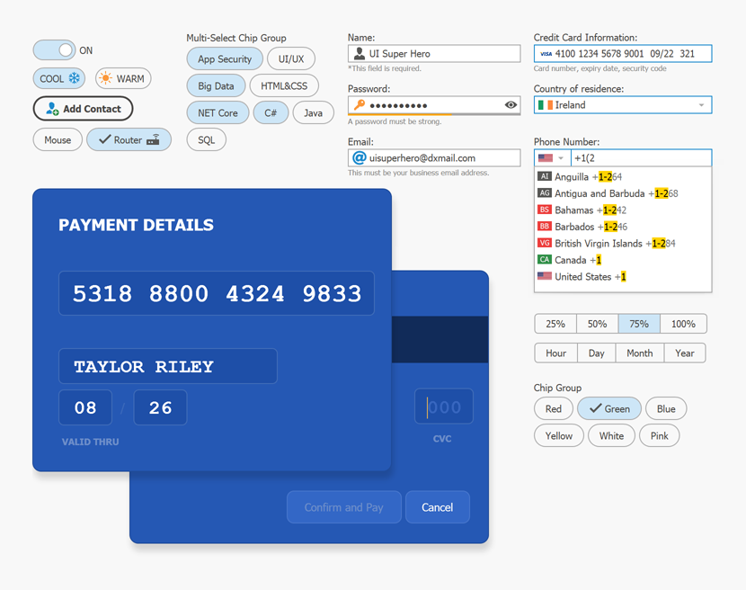

<!-- default badges list -->

<!-- default badges end -->

# WinForms UI Templates

DevExpress WinForms UI Templates include predesigned and ready-to-use UI components and forms (Visual Studio 2022 only). You can use them 'as-is' and seamlessly integrate them into existing projects. All UI templates support the following features:

* [Application Skins](https://docs.devexpress.com/WindowsForms/2399/build-an-application/skins)
* [HTML & CSS Templates](https://docs.devexpress.com/WindowsForms/403397/common-features/html-css-based-desktop-ui)
* [High DPI & DirectX Hardware Acceleration](https://docs.devexpress.com/WindowsForms/116666/common-features/high-dpi-support)
* [WinForms MVVM](https://docs.devexpress.com/WindowsForms/113955/cross-platform-app-development/winforms-mvvm)

## Files to Review

UI templates are located in the `Editors`, `Forms`, and `UserControls` folders. Base classes are in the `Editors/Base` and `Forms/Base` subfolders. Demo pages for the editors are in the `Views` folder.

### C#

#### Editors

| UI Template | File | Example View |
| --- | --- | --- |
| Button | [Editors/Button.cs](./CS/Editors/Button.cs) | [Views/ButtonView.cs](./CS/Views/ButtonView.cs) |
| ChipButton | [Editors/ChipButton.cs](./CS/Editors/ChipButton.cs) | [Views/ChipButtonView.cs](./CS/Views/ChipButtonView.cs) |
| ChipGroup | [Editors/ChipGroup.cs](./CS/Editors/ChipGroup.cs) | [Views/ChipGroupView.cs](./CS/Views/ChipGroupView.cs) |
| CountryChooser | [Editors/CountryChooser.cs](./CS/Editors/CountryChooser.cs) | [Views/CountryChooserView.cs](./CS/Views/CountryChooserView.cs) |
| DateRangePicker | [Editors/DateRangePicker.cs](./CS/Editors/DateRangePicker.cs) | [Views/DateRangePickerView.cs](./CS/Views/DateRangePickerView.cs) |
| EditBox | [Editors/EditBox.cs](./CS/Editors/EditBox.cs) | [Views/EditBoxView.cs](./CS/Views/EditBoxView.cs) |
| EmailBox | [Editors/EmailBox.cs](./CS/Editors/EmailBox.cs) | [Views/EmailBoxView.cs](./CS/Views/EmailBoxView.cs) |
| MultiSelectChipGroup | [Editors/MultiSelectChipGroup.cs](./CS/Editors/MultiSelectChipGroup.cs) | [Views/MultiSelectChipGroupView.cs](./CS/Views/MultiSelectChipGroupView.cs) |
| PasswordBox | [Editors/PasswordBox.cs](./CS/Editors/PasswordBox.cs) | [Views/PasswordBoxView.cs](./CS/Views/PasswordBoxView.cs) |
| PaymentCardBox | [Editors/PaymentCardBox.cs](./CS/Editors/PaymentCardBox.cs) | [Views/PaymentCardBoxView.cs](./CS/Views/PaymentCardBoxView.cs) |
| PhoneNumberBox | [Editors/PhoneNumberBox.cs](./CS/Editors/PhoneNumberBox.cs) | [Views/PhoneNumberBoxView.cs](./CS/Views/PhoneNumberBoxView.cs) |
| RadioButtonGroup | [Editors/RadioButtonGroup.cs](./CS/Editors/RadioButtonGroup.cs) | [Views/RadioButtonGroupView.cs](./CS/Views/RadioButtonGroupView.cs) |
| ToggleButton | [Editors/ToggleButton.cs](./CS/Editors/ToggleButton.cs) | [Views/ToggleButtonView.cs](./CS/Views/ToggleButtonView.cs) |
| ToggleButtonGroup | [Editors/ToggleButtonGroup.cs](./CS/Editors/ToggleButtonGroup.cs) | [Views/ToggleButtonGroupView.cs](./CS/Views/ToggleButtonGroupView.cs) |
| TwinButton | [Editors/TwinButton.cs](./CS/Editors/TwinButton.cs) | [Views/TwinButtonView.cs](./CS/Views/TwinButtonView.cs) |

#### Forms

| UI Template | File |
| --- | --- |
| AddressForm | [Forms/AddressForm.cs](./CS/Forms/AddressForm.cs) |
| CreditCardForm | [Forms/CreditCardForm.cs](./CS/Forms/CreditCardForm.cs) |
| LoginForm | [Forms/LoginForm.cs](./CS/Forms/LoginForm.cs) |
| PasswordForm | [Forms/PasswordForm.cs](./CS/Forms/PasswordForm.cs) |
| PasswordRecoveryForm | [Forms/PasswordRecoveryForm.cs](./CS/Forms/PasswordRecoveryForm.cs) |
| PaymentForm | [Forms/PaymentForm.cs](./CS/Forms/PaymentForm.cs) |

#### User Controls

| UI Template | File |
| --- | --- |
| ContactList | [UserControls/ContactList.cs](./CS/UserControls/ContactList.cs) |
| ContactsSimple | [UserControls/ContactsSimple.cs](./CS/UserControls/ContactsSimple.cs) |
| EmployeeDetails | [UserControls/EmployeeDetails.cs](./CS/UserControls/EmployeeDetails.cs) |
| EmployeeDetailsSimple | [UserControls/EmployeeDetailsSimple.cs](./CS/UserControls/EmployeeDetailsSimple.cs) |
| EmployeesHierarchy | [UserControls/EmployeesHierarchy.cs](./CS/UserControls/EmployeesHierarchy.cs) |
| EmployeesHierarchySimple | [UserControls/EmployeesHierarchySimple.cs](./CS/UserControls/EmployeesHierarchySimple.cs) |
| EmployeesMasterDetail | [UserControls/EmployeesMasterDetail.cs](./CS/UserControls/EmployeesMasterDetail.cs) |
| EmployeesMasterDetailSimple | [UserControls/EmployeesMasterDetailSimple.cs](./CS/UserControls/EmployeesMasterDetailSimple.cs) |

### VB.NET

#### Editors

| UI Template | File | Example View |
| --- | --- | --- |
| Button | [Editors/Button.vb](./VB/Editors/Button.vb) | [Views/ButtonView.vb](./VB/Views/ButtonView.vb) |
| ChipButton | [Editors/ChipButton.vb](./VB/Editors/ChipButton.vb) | [Views/ChipButtonView.vb](./VB/Views/ChipButtonView.vb) |
| ChipGroup | [Editors/ChipGroup.vb](./VB/Editors/ChipGroup.vb) | [Views/ChipGroupView.vb](./VB/Views/ChipGroupView.vb) |
| CountryChooser | [Editors/CountryChooser.vb](./VB/Editors/CountryChooser.vb) | [Views/CountryChooserView.vb](./VB/Views/CountryChooserView.vb) |
| DateRangePicker | [Editors/DateRangePicker.vb](./VB/Editors/DateRangePicker.vb) | [Views/DateRangePickerView.vb](./VB/Views/DateRangePickerView.vb) |
| EditBox | [Editors/EditBox.vb](./VB/Editors/EditBox.vb) | [Views/EditBoxView.vb](./VB/Views/EditBoxView.vb) |
| EmailBox | [Editors/EmailBox.vb](./VB/Editors/EmailBox.vb) | [Views/EmailBoxView.vb](./VB/Views/EmailBoxView.vb) |
| MultiSelectChipGroup | [Editors/MultiSelectChipGroup.vb](./VB/Editors/MultiSelectChipGroup.vb) | [Views/MultiSelectChipGroupView.vb](./VB/Views/MultiSelectChipGroupView.vb) |
| PasswordBox | [Editors/PasswordBox.vb](./VB/Editors/PasswordBox.vb) | [Views/PasswordBoxView.vb](./VB/Views/PasswordBoxView.vb) |
| PaymentCardBox | [Editors/PaymentCardBox.vb](./VB/Editors/PaymentCardBox.vb) | [Views/PaymentCardBoxView.vb](./VB/Views/PaymentCardBoxView.vb) |
| PhoneNumberBox | [Editors/PhoneNumberBox.vb](./VB/Editors/PhoneNumberBox.vb) | [Views/PhoneNumberBoxView.vb](./VB/Views/PhoneNumberBoxView.vb) |
| RadioButtonGroup | [Editors/RadioButtonGroup.vb](./VB/Editors/RadioButtonGroup.vb) | [Views/RadioButtonGroupView.vb](./VB/Views/RadioButtonGroupView.vb) |
| ToggleButton | [Editors/ToggleButton.vb](./VB/Editors/ToggleButton.vb) | [Views/ToggleButtonView.vb](./VB/Views/ToggleButtonView.vb) |
| ToggleButtonGroup | [Editors/ToggleButtonGroup.vb](./VB/Editors/ToggleButtonGroup.vb) | [Views/ToggleButtonGroupView.vb](./VB/Views/ToggleButtonGroupView.vb) |
| TwinButton | [Editors/TwinButton.vb](./VB/Editors/TwinButton.vb) | [Views/TwinButtonView.vb](./VB/Views/TwinButtonView.vb) |

#### Forms

| UI Template | File |
| --- | --- |
| AddressForm | [Forms/AddressForm.vb](./VB/Forms/AddressForm.vb) |
| CreditCardForm | [Forms/CreditCardForm.vb](./VB/Forms/CreditCardForm.vb) |
| LoginForm | [Forms/LoginForm.vb](./VB/Forms/LoginForm.vb) |
| PasswordForm | [Forms/PasswordForm.vb](./VB/Forms/PasswordForm.vb) |
| PasswordRecoveryForm | [Forms/PasswordRecoveryForm.vb](./VB/Forms/PasswordRecoveryForm.vb) |
| PaymentForm | [Forms/PaymentForm.vb](./VB/Forms/PaymentForm.vb) |

#### User Controls

| UI Template | File |
| --- | --- |
| ContactList | [UserControls/ContactList.vb](./VB/UserControls/ContactList.vb) |
| ContactsSimple | [UserControls/ContactsSimple.vb](./VB/UserControls/ContactsSimple.vb) |
| EmployeeDetails | [UserControls/EmployeeDetails.vb](./VB/UserControls/EmployeeDetails.vb) |
| EmployeeDetailsSimple | [UserControls/EmployeeDetailsSimple.vb](./VB/UserControls/EmployeeDetailsSimple.vb) |
| EmployeesHierarchy | [UserControls/EmployeesHierarchy.vb](./VB/UserControls/EmployeesHierarchy.vb) |
| EmployeesHierarchySimple | [UserControls/EmployeesHierarchySimple.vb](./VB/UserControls/EmployeesHierarchySimple.vb) |
| EmployeesMasterDetail | [UserControls/EmployeesMasterDetail.vb](./VB/UserControls/EmployeesMasterDetail.vb) |
| EmployeesMasterDetailSimple | [UserControls/EmployeesMasterDetailSimple.vb](./VB/UserControls/EmployeesMasterDetailSimple.vb) |

<!-- feedback -->
## Does This Example Address Your Development Requirements/Objectives?

 

(you will be redirected to DevExpress.com to submit your response)
<!-- feedback end -->
